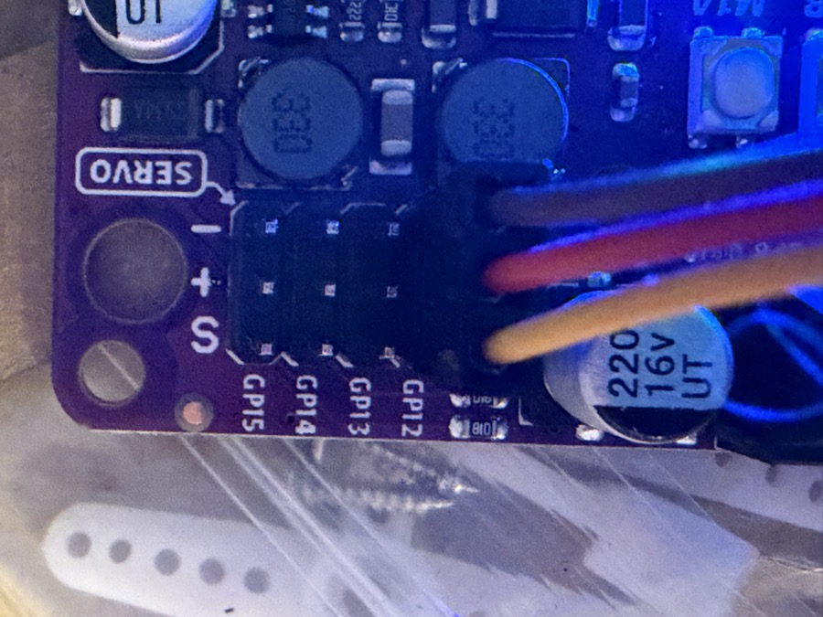

# Servo-Motor

Dreht den Servo auf einen Winkel von 0–180 Grad.

So steckst du den Servo an: Das **orange** Kabel kommt an **S**, **rot** an **+**, **braun** an **−**.
Auf dem MAKER-PI steht neben jeder Reihe der Pin: **GP12 = S1**, GP13 = S2, GP14 = S3, GP15 = S4.

<!-- lang:en -->

# Servo motor

Turns the servo to an angle of 0–180 degrees.

How to plug in the servo: the **orange** wire goes to **S**, **red** to **+**, **brown** to **−**.
On the MAKER-PI each row is labelled with its pin: **GP12 = S1**, GP13 = S2, GP14 = S3, GP15 = S4.

