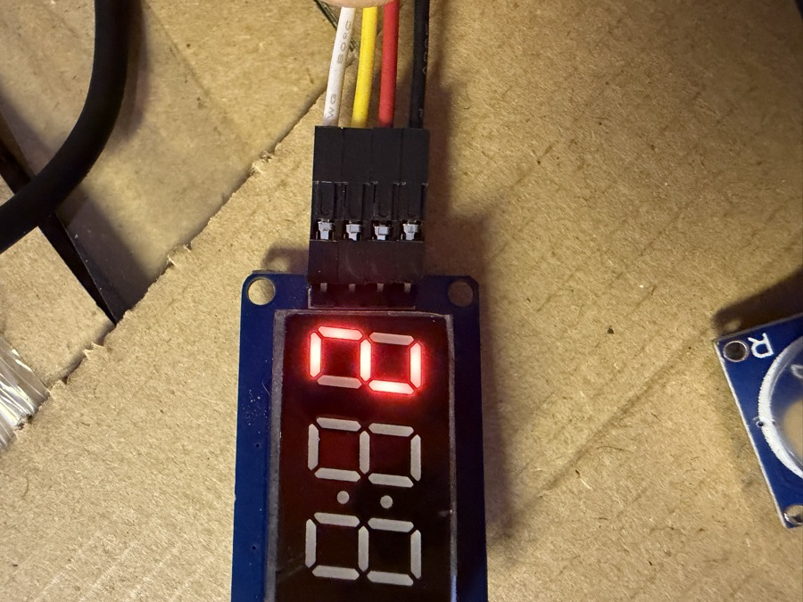
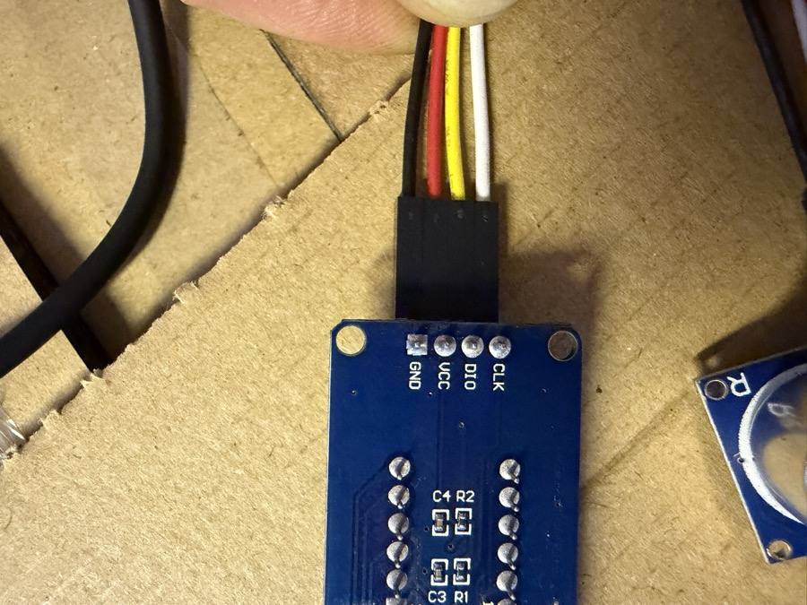

# TM1637 4-stelliges 7-Segment-Display – Zahl anzeigen

Zeigt eine ganze Zahl (−999 bis 9999) auf dem Display an.

**Verdrahtung (Grove-Port):**
- CLK → Grove Pin 1 (weiß, z. B. GP2 bei Grove 2)
- DIO → Grove Signal (gelb, z. B. GP3 bei Grove 2)
- VCC / GND → Grove VCC / GND

**Lib:** `adafruit_tm1637` aus dem Adafruit CircuitPython Bundle → nach `CIRCUITPY/lib/` kopieren.

<!-- lang:en -->

# TM1637 4-digit 7-segment display – show number

Shows an integer (−999 to 9999) on the display.

**Wiring (Grove port):**
- CLK → Grove pin 1 (white, e.g. GP2 on Grove 2)
- DIO → Grove signal (yellow, e.g. GP3 on Grove 2)
- VCC / GND → Grove VCC / GND

**Lib:** `adafruit_tm1637` from the Adafruit CircuitPython Bundle → copy to `CIRCUITPY/lib/`.
