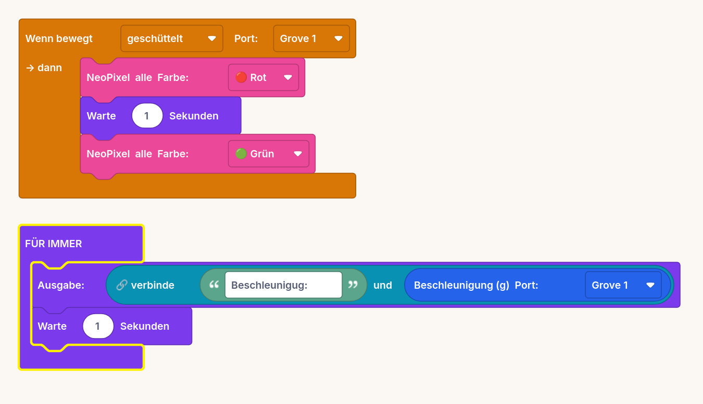

# Bewegungssensor – Beschleunigung (g)

Liefert die Gesamt-Beschleunigung als Zahl in g. In Ruhe zeigt der Sensor ≈ 1,0
(Erdanziehung), beim Schütteln oder Aufprall deutlich mehr. Messbereich: bis ±16 g.

## Beispiel

Beim Schütteln leuchten die NeoPixel kurz rot, parallel wird der g-Wert jede Sekunde ausgegeben:

> Passende Sensoren werden automatisch erkannt: Seeed **Grove IMU 9DOF** (MPU-9250
> oder ICM-20600), MPU-6050 und Adafruit ICM20948. Treiber: `grove_imu.py` auf
> `CIRCUITPY/lib/` (beim ICM20948 zusätzlich `adafruit_icm20x.mpy` + `adafruit_register/`).

<!-- lang:en -->

# Motion sensor – acceleration (g)

Returns the total acceleration as a number in g. At rest the sensor shows ≈ 1.0
(gravity); when shaken or on impact considerably more. Measuring range: up to ±16 g.

## Example

When shaken, the NeoPixels briefly light up red while the g value is printed every second:

> Supported sensors are detected automatically: Seeed **Grove IMU 9DOF** (MPU-9250
> or ICM-20600), MPU-6050 and Adafruit ICM20948. Driver: `grove_imu.py` on
> `CIRCUITPY/lib/` (for the ICM20948 also `adafruit_icm20x.mpy` + `adafruit_register/`).
